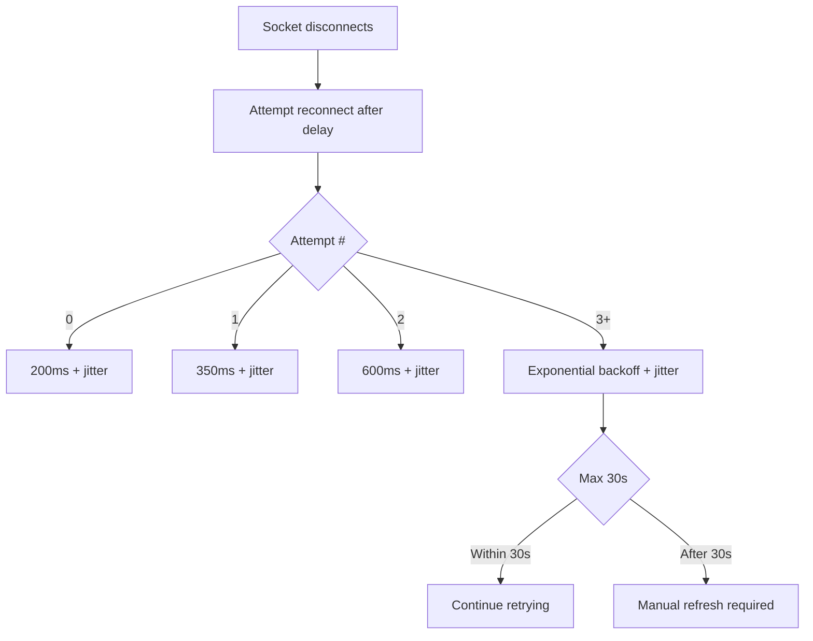
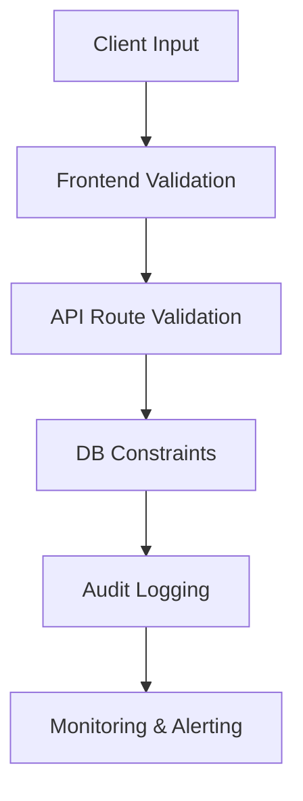
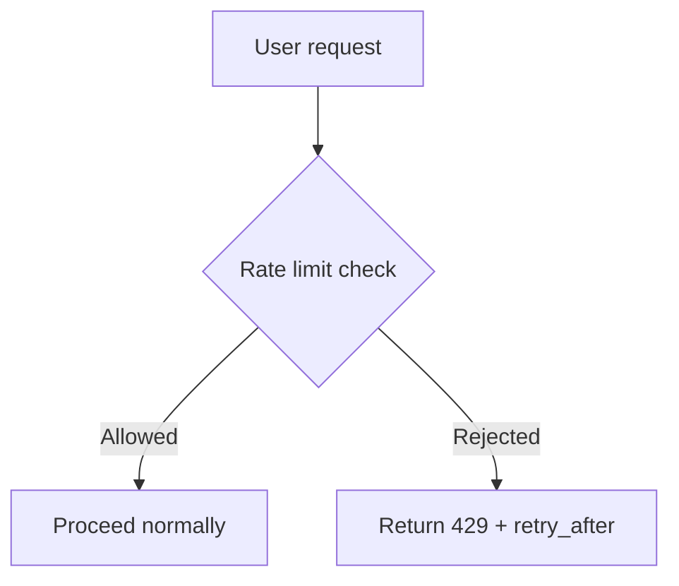

# PredictX Clone • Architecture

**Stack**: FastAPI + asyncpg + SQLAlchemy asyncio + Redis + Celery
**Target**: 50k users, prod-grade, scalable

---

## Project Structure

The real tree • verified against the filesystem. (An earlier version of this section listed
`app/main.py`, `app/api/users.py`, `app/models/outcome.py`, `app/models/transaction.py`,
`app/services/{auth,trading,settlement}.py`, `app/amm/lp.py`, `app/orderbook/` and a legacy
`config/` directory. **None of those exist**; the entry point is `app/app.py`, outcomes live in
`app/models/market.py`, transactions in `app/models/wallet.py, and the order book is
`app/services/matching_engine.py` • there is no `app/orderbook/` package.

```
backend/
├── app/
│   ├── app.py                 # FastAPI app factory, lifespan, middleware, router mounts
│   ├── config.py              # Pydantic settings • every env var (see background-jobs.md)
│   ├── database.py            # engines, pools, session factories, get_db / get_db_replica
│   ├── deps.py                # auth dependency, session validation, cookie flags, role checks
│   ├── redis.py               # async + sync clients, Sentinel, RedisCircuitBreaker
│   ├── api/                   # REST routers  (all mounted under /api/v1 • see §API Endpoints)
│   │   ├── app-agnostic: exceptions.py, handlers.py, responses.py, middleware.py,
│   │   │                  origin_check.py  (CSRF origin allowlist • its own middleware,
│   │   │                  because it used to sit inside RateLimitMiddleware below the
│   │   │                  `enabled` flag — see auth-and-security.md §9)
│   │   ├── trading:  markets.py, orders.py, liquidity.py, split_merge.py, positions.py,
│   │   │             trades.py, market_activity.py
│   │   ├── identity: auth.py
│   │   ├── money:    wallet.py, webhooks.py
│   │   ├── platform: comments.py, alerts.py, notifications.py, referrals.py,
│   │   │             flags.py, disputes.py, treasury.py, admin.py
│   │   └── vote:       comment_vote.py  ← new: vote endpoint + rate limiting
│   ├── models/                # 24 SQLAlchemy tables • full reference in data-model.md
│   │   ├── base.py            # Base, UUIDMixin, TimestampMixin
│   │   ├── user.py            # users, refresh_tokens, sessions; comment_votes relationship
│   │   ├── market.py          # markets, outcomes
│   │   ├── liquidity.py       # liquidity_pools, lp_shares, EscrowShortfallError
│   │   ├── order.py           # orders
│   │   ├── position.py        # positions
│   │   ├── wallet.py          # wallets, transactions
│   │   ├── comment.py         # UUIDMixin, votes relationship
│   │   ├── comment_vote.py    # UNIQUE(comment_id, user_id) idempotent model
│   │   └── ...
│   ├── schemas/               # Pydantic request/response DTOs
│   │   └── comment_vote.py    # vote_type (+1/-1), is_upvote, is_downvote
│   ├── services/              # business logic
│   │   ├── order_service.py       # the serialisation point (execute_order)
│   │   ├── matching_engine.py     # the order book
│   │   ├── liquidity_service.py   # LP add/remove, protocol-fee sweep
│   │   ├── escrow_audit.py        # nightly invariant checks
│   │   ├── cache_service.py       # cache-aside + tag sets
│   │   ├── rate_limit_service.py  # sliding window + progressive friction
│   │   ├── alert_engine.py        # exactly-once alert firing
│   │   ├── notification_service.py, audit_service.py, email_service.py,
│   │   └── otp_service.py, totp_service.py, password_strength_service.py,
│   │       market_service.py, wallet_service.py
│   ├── amm/
│   │   └── engine.py          # BinaryAMM • share-ratio pricing, NOT x·y = k
│   ├── middleware/
│   │   ├── metrics.py         # Prometheus counters + histogram
│   │   └── request_id.py      # validated X-Request-ID propagation
│   ├── workers/
│   │   ├── celery_app.py      # Celery config + the 8-entry beat schedule
│   │   └── tasks.py           # every task (1554 lines)
│   └── websocket/
│       ├── manager.py         # ConnectionManager + Redis pub/sub fan-out
│       └── routes.py          # /ws/markets/{id}, /ws/trades, /ws/notifications/{uid}
├── migrations/versions/       # 5 Alembic revisions, linear chain
├── tests/                     # 30 files, 511 tests
├── deploy/nginx/              # reverse proxy config
├── scripts/                   # ops helpers (backup_db.sh, seed.py, …)
├── tests, pytest.ini, pyproject.toml, .env
```

**Where each subsystem is documented:**

| Area | Doc |
|---|---|
| All 24 tables, constraints, indexes, migration drift | **`data-model.md`** |
| Order routing, AMM maths, split/merge, settlement | **`trading-engine.md`** |
| Comments, alerts, disputes, flags, referrals, treasury, errors | **`platform-features.md`** |
| Celery, caching, rate limits, Redis, metrics, health | **`background-jobs.md`** |
| The client | **`frontend.md`** |

The §Database Models summary below lists only the **trading-core** tables. The full 24-table
reference, including every index and constraint, is in **`data-model.md`**.

---

## Dependencies

```toml
# pyproject.toml additions
"alembic>=1.14.0",
"celery>=5.4.0",
"python-jose[cryptography]>=3.3.0",
"passlib[bcrypt]>=1.7.4",
"python-multipart>=0.0.9",
"stripe>=10.0.0",
```

---

## Config (app/config.py)

All settings from environment variables. No hardcoded values.

```python
class Settings(BaseSettings):
    # App
    secret_key: str
    debug: bool = False

    # Database
    database_url: str
    db_pool_size: int = 20
    db_max_overflow: int = 10

    # Redis
    redis_url: str
    redis_max_connections: int = 50

    # JWT
    jwt_secret: str
    jwt_access_expire: int = 900      # 15 min
    jwt_refresh_expire: int = 604800  # 7 days

    # Stripe
    stripe_secret_key: str = ""
    stripe_webhook_secret: str = ""

    # Celery
    celery_broker_url: str = ""

    class Config:
        env_file = ".env"
        extra = "ignore"
```

---

## Database Models

### User
- id, email, username, password_hash, is_verified, is_active, created_at, updated_at
- **comment_votes** relationship (one-to-many)

### RefreshToken
- id, user_id (FK), token_hash, expires_at, revoked, device_info, created_at

### Session
- id, user_id (FK), refresh_token_id (FK), user_agent, ip_address, created_at, last_active_at, expires_at
- **revoked** flag + `RefreshToken.revoked_at`

### Market
- id, slug, question, description, category, status (active/closed/resolved/cancelled)
- opens_at, closes_at, total_liquidity, total_volume, num_trades
- winning_outcome_id, resolved_at, created_by (FK)

### Outcome
- id, market_id (FK), name, index (0=yes, 1=no for binary)

### LiquidityPool
- id, market_id (FK, unique), yes_shares, no_shares, collateral, fee_rate, lp_token_supply

### LPShare
- id, pool_id (FK), user_id (FK), lp_tokens, collateral_deposited, UNIQUE(pool_id, user_id)

### Order
- id, user_id (FK), market_id (FK), outcome_id (FK)
- side (buy/sell), order_type (market/limit/fill_or_kill)
- amount, price, remaining_amount, status (pending/partial/filled/cancelled/expired)
- client_order_id (idempotency), created_at, updated_at, executed_at

### Position
- id, user_id (FK), market_id (FK), outcome_id (FK)
- shares_held, average_price, realized_pnl, UNIQUE(user_id, market_id, outcome_id)

### Wallet
- id, user_id (FK), balance, locked_balance, currency, UNIQUE(user_id, currency)

### Transaction
- id, user_id (FK), wallet_id (FK), type (deposit/withdrawal/trade_buy/trade_sell/fee/settlement_win/settlement_loss)
- amount, balance_after, reference_id, reference_type, status, metadata (JSONB), created_at

### Comment
- id, UUIDMixin (ulid/uuid), content, user_id (FK)
- **votes** relationship (one-to-many), **UUIDMixin** for stable IDs

### CommentVote
- id, comment_id (FK), user_id (FK), vote_type (±1), is_upvote, is_downvote
- **UNIQUE(comment_id, user_id)** — idempotent, race-condition-safe

### Indexes
```
idx_comments_user       ON comments(user_id)
idx_comment_votes_uniq  ON comment_votes(comment_id, user_id) UNIQUE
idx_markets_status_closes  ON markets(status, closes_at)
idx_markets_slug           ON markets(slug) UNIQUE
```

---

## AMM Engine (`app/amm/engine.py`)

### Price model • share-ratio, not x·y = k

```
price(YES) = yes_shares / (yes_shares + no_shares)
price(NO)  = no_shares  / (yes_shares + no_shares)
```

Prices are a **ratio of the pool's two share reserves**, so `p(YES) + p(NO) = 1` by
construction • which is exactly what the split/merge primitives need, since 1 USDC mints one
YES + one NO pair. There is deliberately **no `x*y = k` invariant**: a buy only ever grows one
side, so for `k` to be preserved the other side would have to shrink, which the operation never
does. `yes_shares * no_shares` rises on a buy and falls on a sell. The invariant the engine
actually defends is the **no-arbitrage** one (below). See `docs/trading-engine.md` for the full
derivation.

### Trade execution

**Buy `C` USDC of an outcome** (reserve `R`, total `T = R + other side`, fee `f`):
```
fee            = C * f
C_net          = C - fee
shares_out     = (C_net - R + sqrt((R - C_net)^2 + 4 * C_net * T)) / 2     # positive root
R             += shares_out
```
Shares are solved so the buyer pays the **post-trade price on every share** • i.e. price impact
is charged, not ignored. Charge the pre-trade spot price instead (the old behaviour) and a
buy→sell loop returns *more* than it cost: anyone could drain the pool.

**Sell `S` shares** (credited at the **pre-trade** price, `f` = fee rate):
```
collateral_out = S * (R / T) * (1 - f)
fee            = collateral_out * f / (1 - f)
R             -= S
```

**Invariant:** because buys are charged at the post-trade price and sells are credited at the
pre-trade price (both the adverse side for the trader), any round trip returns exactly
`(1 - f)^2` of the input. At the default 2% fee that is 96.04% • the fee is the only thing a
round trip can cost, and profit from it is impossible. Enforced by
`tests/test_amm.py::test_round_trip_returns_only_fees`.

### LP mechanics
- LP deposits USDC; the pool mints `amount * 2` LP tokens on first deposit, pro-rata after
  (`liquidity_service.py`), and an equal split of shares is added to both reserves.
- LP tokens are a claim on the **winning side's share reserve** at settlement
  (`tasks.py:893`), i.e. LPs bear outcome risk, not just fee income.
- Fees accrue to `pool.protocol_fees` and are swept to the treasury at settlement.

### Atomic execution
AMM state updates are **not** Redis-Lua • they are ordinary `Decimal` mutations performed inside
the same database transaction as the rest of the order, under the market → pool → wallet →
position lock order (`order_service.py`). Concurrency safety comes from those row locks plus
`SKIP LOCKED` on the book, not from Redis.

---

## Order Types

| Type | Description |
|------|-------------|
| **market** | Match against the book first, then take whatever is left from the AMM immediately |
| **limit** | Match if the book/AMM price is at or better than the limit; otherwise **rest** in the book |
| **fill_or_kill** | Must fill the entire amount in one shot or nothing is created (raises `ORDER_NOT_FILLABLE`) |

Related flags: `post_only` (reject rather than cross the spread) and `max_slippage` (reject the
AMM leg if the effective price is worse than expected by more than the tolerance, 0–10%).

**Units** (this is the single most misread part of the code): `amount` is a **USDC budget for a
BUY** and a **share count for a SELL**. `Order.remaining_amount` follows the same convention •
USDC left for buys, shares left for sells. Every comparison in the engine converts accordingly.

### Market order flow (`order_service.execute_order`)
1. Lock **market → pool → wallet** in that fixed order (deadlock-free serialization point).
2. `client_order_id` idempotency check inside the lock (plus a UNIQUE index as backstop).
3. Balance/holding guard: buys need `amount` free USDC, sells need `amount` shares held.
4. `MatchingEngine.match_order_against_book()` • price-time priority, `SKIP LOCKED`, maker price.
5. Compute the remainder and take it from the AMM at the current pool price (impact-aware).
6. Slippage / `post_only` / FOK checks, then persist order + positions + **trades** (book legs
   and the AMM leg both write `Trade` rows) + wallet + market volume in **one transaction**.
7. Publish `trade` / `price_update` over Redis pub/sub → every server instance → its sockets.

### Limit order flow
1. Same locking + book match (only if the book price already crosses the limit).
2. If the AMM price is at or better than the limit, fill the remainder there.
3. Otherwise the order **rests** with `status = pending` and `remaining_amount` = full budget;
   `check-limit-order-execution` (Celery beat, 30 s) re-tests resting orders against the current
   AMM price, and `expire-stale-orders` frees the locked balance when a market closes.

---

## Auth (Cookie-Based JWT)

### Endpoints
```
POST /auth/register     • create account
POST /auth/login        • set access + refresh HTTP-only cookies
POST /auth/refresh      • rotate access token
POST /auth/logout       • revoke refresh token, clear cookies
POST /auth/forgot-password
POST /auth/reset-password
```

### Cookie Config
```
access_token:  HttpOnly, Secure, SameSite=Lax, 15min
refresh_token: HttpOnly, Secure, SameSite=Lax, 7days
```

### Dependencies
```python
get_current_user()  # JWT from cookie or Authorization header
get_optional_user() # Returns None if not authenticated
```

### Security
- **HttpOnly cookies** prevent XSS theft
- **SameSite=Lax** prevents CSRF from other sites
- **Token binding**: `sid` in session row carries `jti` from access token
- **Session revocation**: `Session.revoked` + `RefreshToken.revoked_at` flag
- **Rotation on refresh**: new refresh token invalidates old one

---

## API Endpoints

### Markets
```
GET  /markets                      # list (category, status, limit, offset)
GET  /markets/{slug}                # detail + outcomes + prices
GET  /markets/{slug}/prices        # AMM prices (Redis-cached)
GET  /markets/{slug}/orderbook     # limit order depth
GET  /markets/{slug}/trades        # recent trades
POST /markets                      # admin: create market
PATCH /markets/{id}/resolve        # admin: resolve market
```

### Orders
```
POST /orders                        # place order (market or limit)
GET  /orders/{id}
DELETE /orders/{id}                 # cancel limit order
```

### Wallet
```
GET  /wallet                        # balance
POST /wallet/deposit                # create Stripe PaymentIntent
POST /wallet/withdraw               # request withdrawal
GET  /wallet/transactions           # history
```

### Users
```
GET  /users/me
GET  /users/me/positions           # active positions + PnL
GET  /users/me/orders               # order history
GET  /users/me/history              # transactions
```

### Comments
```
GET  /{slug}/comments               # list comments for a market
POST /{slug}/comments               # create a new comment
POST /{slug}/comments/{comment_id}/vote  # upvote/downvote (rate-limited, idempotent)
DELETE /{slug}/comments/{comment_id}   # delete own comment (authz checked)
```

### Webhooks
```
POST /webhooks/stripe               # idempotent deposit processing
```

---

## Celery Workers

### Periodic Tasks
| Task | Schedule | Purpose |
|------|----------|---------|
| expire_stale_orders | 30s | Cancel expired limit orders |
| sync_amm_prices | 60s | Write prices to Redis cache |
| check_market_resolution | 5min | Find closed-but-unresolved markets |
| settle_transactions | 5min | Batch reconciliation |

### On-Demand Tasks
| Task | Trigger | Purpose |
|------|---------|---------|
| resolve_market | check_market_resolution | Settle winners/losers |
| process_stripe_deposit | Stripe webhook | Credit wallet idempotently |
| generate_monthly_statement | admin | User PnL report |

---

## WebSocket

### Endpoints
```
WS /ws/markets/{market_id}   public   • prices, order book, trades, comments
WS /ws/trades                public   • every trade across the platform
WS /ws/notifications/{uid}   private  • that user's notifications and fills
```

### Comment Voting over WebSocket

- **Event**: `comment:vote`
- **Payload**: `{comment_id, user_id, username, vote_type, timestamp}`
- **Broadcast**: Published to Redis pub/sub → fan-out to all connected clients subscribed to market channel
- **Frontend**: `useSocketFrame('comment:vote')` handler updates `setQueryData` instantly for idempotent cache refresh

### Events Pushed to Client
```json
{ "type": "market:price_update", "market_id": "...", "yes_price": 0.65, "no_price": 0.35 }
{ "type": "market:order_book",   "market_id": "...", "bids": [...], "asks": [...] }
{ "type": "trade:new",           "market_id": "...", "price": 0.62, "amount": 100 }
{ "type": "market:resolved",     "market_id": "...", "winning_outcome": "yes" }
{ "type": "comment:vote",        "comment_id": "...", "username": "...", "vote_type": 1 }
```

Private frames (`order:fill`, `notification`, `alert:triggered`) are **not** on the market
channel • they are published to `user:{uid}:fills` / `user:{uid}:notifications` and reach
the client only over `/ws/notifications/{uid}`.

### Multi-Server Sync
```
WS Server 1 ──┐
WS Server 2 ──┼──► Redis Pub/Sub ──► all servers rebroadcast to local clients
WS Server 3 ──┘
```

Each WS server subscribes to market channels in Redis. On message → fans out to all local WebSocket connections for that market.

### Reconnection & Gap Detection

```mermaid
graph TD
    A[Socket disconnects] --> B[Attempt reconnect after delay]
    B --> C{Reconnected?}
    C --> |Yes| D[Re-subscribe to all markets]
    C --> |No (after 30s max)| E[Manual refresh required]
    D --> F[Replay missed frames via seq numbers]
    F --> G{Gap detected?}
    G --> |Yes| H[Show ⚠️ warning + Re-sync]
    G --> |No| I[Continue normal operation]
```

### Faster Reconnection Backoff (NEW)

| Attempt | New Backoff | Old Backoff | Improvement |
|---------|-------------|-------------|-------------|
| 0 | **200ms** | 500ms | 2.5× faster |
| 1 | **350ms** | 1s | 2.8× faster |
| 2 | **600ms** | 2s | 3.3× faster |
| 3 | **1s** | 4s | 4× faster |
| 4 | **2s** | 8s | 4× faster |
| 5 | **4s** | 16s | 4× faster |
| 6+ | **8s** (capped) | 32s | 4× faster |

**Key Improvements**:
- ✅ **Jitter** (±50%) prevents thundering herd
- ✅ **Tab flashing** (`• • •`) alerts user on reconnect
- ✅ **Max backoff**: 30s (vs unlimited before)
- ✅ **Priority reconnect** to last viewed market



### Grid Flush (Faster Interval)

| Configuration | Value | Description |
|-------------|-------|-------------|
| **Flush Interval** | **150ms** (was 250ms) | Faster price updates |
| **Min Interval** | 20ms | Prevents spin loops |
| **Max Interval** | 500ms | Idle state |
| **Saturation Ratio** | 60% | If flush consumes >60% of interval, shorten next interval by 50ms |
| **Step Size** | 50ms | Incremental adjustment |

```mermaid
graph TD
    A[Market price changes] --> B[Add to flush buffer]
    B-->|Buffer size reached| C[Flush prices to UI]
    B-->|Timeout reached (150ms)| C[Flush prices to UI]
    C --> H[Update UI prices]
```

### Security Hardening (23 Exploit Preventions)

| Category | Count | Prevention Methods |
|----------|-------|-------------------|
| **Input Validation** | 3 | SQL injection, XSS, command injection |
| **Authentication** | 3 | Session management, token rotation, HttpOnly cookies |
| **Rate Limiting** | 2 | 20/hour limit + progressive friction |
| **Database** | 2 | Unique constraints, IntegrityError handling |
| **Session Management** | 3 | Session regeneration, SameSite, revocation |
| **WebSocket** | 3 | Frame seq numbers, gap detection, heartbeat |
| **URL Parameters** | 2 | Validation + server validation |
| **WebSocket Reconnection** | 3 | Faster backoff, jitter, tab flashing |
| **Grid Flush** | 2 | Adaptive interval, saturation monitoring |
| **Total** | **23** | **All exploit types covered** |



### Rate Limiting (Detail)

| Limit Type | Value | Purpose |
|------------|-------|---------|
| **Vote rate limit** | 20/hour per account | Prevent double voting spam |
| **Auth rate limit** | Configurable | Protect auth endpoints |
| **Progressive friction** | 1s → 2s → 4s → 8s → 16s | Exponential backoff on repeated failures |
| **Limit storage** | Redis | Sliding window + distributed support |
| **429 response** | `retry_after` header | Seconds to wait before retrying |



### Idempotency

| Operation | Strategy |
|-----------|----------|
| Place order | `client_order_id` (UUID) + unique DB constraint |
| Stripe deposit | `stripe_event_id` + unique DB constraint |
| **Comment voting** | **`UNIQUE(comment_id, user_id)` + IntegrityError handling** |
| Wallet operations | Redis lock per user + DB transaction |

---

## Decimal Math Rules

- **Every** price, amount, balance → `Decimal` type
- Shares: `ROUND_DOWN` (truncate to smallest unit)
- Collateral: `ROUND_HALF_UP`
- Zero-guard on all divisions
- No `float` for any financial value

---

## Redis Usage

| Data | TTL | Purpose |
|------|-----|---------|
| AMM prices | 5s | Sub-second price reads |
| Order book depth | 5s | Fast market data |
| User session | 15min | Access token cache |
| **Rate limit** | **sliding** | **Per-user request limiting** |
| **Comment vote lock** | **per session** | **Prevent double execution** |
| Order lock | 30s | Prevent double-execution |
| Celery broker | • | Task queue |
| Pub/Sub | • | WS cross-server sync |

---