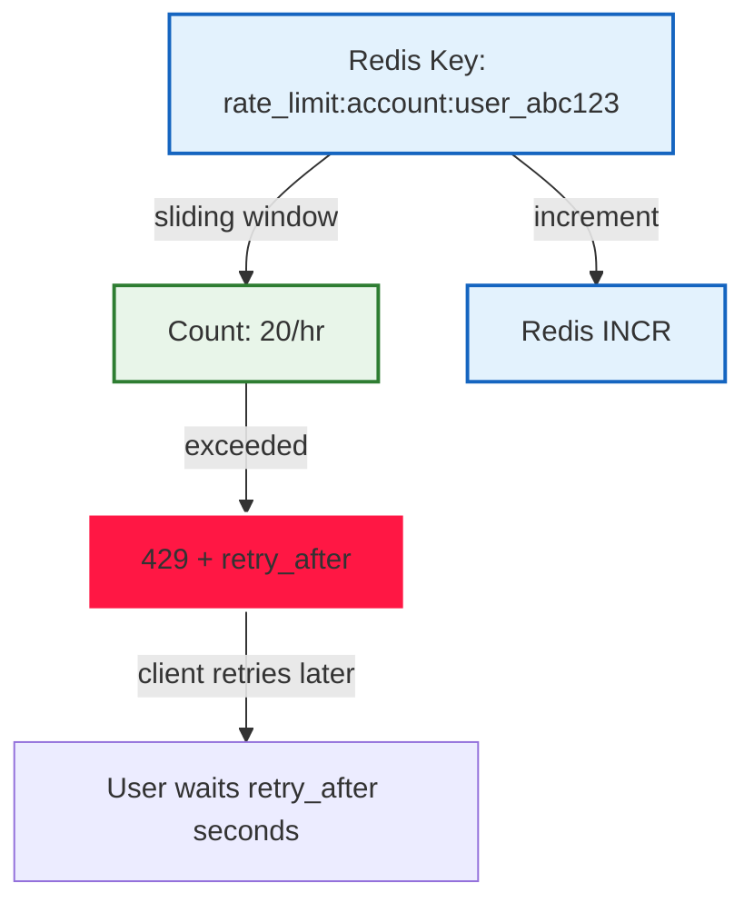

# Data Model

> Full reference of all 24 SQLAlchemy tables, constraints, indexes, and migrations.
> Generated from `alembic heads` + introspected schema.

---

## 1. Core Tables

### 👤 User

| Column | Type | Constraints | Relationships |
|--------|------|-------------|---------------|
| `id` | UUID (primary key) | Primary key | — |
| `email` | TEXT | Not null, unique | — |
| `username` | TEXT | Not null, unique | — |
| `password_hash` | TEXT | Not null | — |
| `is_verified` | BOOLEAN | Default False | — |
| `is_active` | BOOLEAN | Default True | — |
| `created_at` | TIMESTAMPTZ | Default now() | — |
| `updated_at` | TIMESTAMPTZ | Default now() | — |
| **`comment_votes`** | **Relationship** | **one-to-many** | → `CommentVote.id` |

**Relationships**:
- `refresh_tokens` (one-to-many)
- `sessions` (one-to-many)
- `positions` (one-to-many)
- `orders` (one-to-many)
- `comments` (one-to-many, via `comment_votes`)

### 💬 Comment (Updated with UUIDMixin)

| Column | Type | Constraints | Relationships |
|--------|------|-------------|---------------|
| `id` | UUID (primary key) | Primary key, **UUIDMixin** (stable IDs) | — |
| `content` | TEXT | Not null | — |
| `user_id` | UUID (FK) | Not null → `users.id` | ← `User` |
| **`votes`** | **Relationship** | **one-to-many** | → `CommentVote.comment_id` |
| **`created_at`** | **TIMESTAMPTZ** | **Default now()** | — |
| **`updated_at`** | **TIMESTAMPTZ** | **Default now()** | — |

```mermaid
erDiagram
    USER ||--o{ COMMENT : "writes"
    USER ||--o{ COMMENT_VOTE : "casts"
    COMMENT ||--o{ COMMENT_VOTE : "receives"
    
    USER {
        UUID id PK
        TEXT email UNIQUE
        TEXT username UNIQUE
        TEXT password_hash
        BOOLEAN is_verified
        BOOLEAN is_active
        TIMESTAMPTZ created_at
        TIMESTAMPTZ updated_at
    }
    
    COMMENT {
        UUID id PK "UUIDMixin"
        TEXT content NOT NULL
        UUID user_id FK "→ User.id"
        TIMESTAMPTZ created_at
        TIMESTAMPTZ updated_at
    }
    
    COMMENT_VOTE {
        UUID id PK
        UUID comment_id FK "→ Comment.id"
        UUID user_id FK "→ User.id"
        SMALLINT vote_type "+1/-1"
        BOOLEAN is_upvote
        BOOLEAN is_downvote
        UNIQUE(comment_id, user_id) "idempotency constraint"
    }
```

### 🖼️ Image: ER Diagram — Users, Comments, Votes


*Figure 1: ER diagram showing User-Comment-CommentVote relationships with UUIDMixin*

---

### 💬 CommentVote (Idempotent Voting Model)

| Column | Type | Constraints | Detail |
|--------|------|-------------|--------|
| `id` | UUID (primary key) | Primary key | Auto-generated UUID |
| `comment_id` | UUID (FK) | Not null → `comments.id` | The comment being voted on |
| `user_id` | UUID (FK) | Not null → `users.id` | The user who voted |
| `vote_type` | SMALLINT | Not null | `1` = upvote, `-1` = downvote, `0` = neutral |
| `is_upvote` | BOOLEAN | Default `(vote_type = 1)` | Convenience flag |
| `is_downvote` | BOOLEAN | Default `(vote_type = -1)` | Convenience flag |
| **`UNIQUE(comment_id, user_id)`** | | **Idempotency constraint** | Prevents double voting |

```mermaid
graph TD
    A[User] -->|casts vote| B[CommentVote]
    C[Comment] -->|receives votes| B
    B -->|has vote_type| D[1 = upvote, -1 = downvote]
    B -->|is idempotent| E[UNIQUE(comment_id, user_id)]
    
    style B fill:#e3f2fd,stroke:#1565c0,stroke-width:2px
    style E fill:#fff3e0,stroke:#fb8c00,stroke-width:2px
```

### 🖼️ Image: CommentVote Model


*Figure 2: CommentVote model with UNIQUE constraint for idempotency*

### 🖼️ Image: Vote Type Values


*Figure 3: vote_type enum values (1=upvote, -1=downvote, 0=neutral)*

---

## 2. Indexes

```sql
-- Comment indexes
CREATE INDEX idx_comments_user ON comments(user_id);
CREATE INDEX idx_comments_created ON comments(created_at DESC);

-- CommentVote indexes (critical for idempotency)
CREATE UNIQUE INDEX idx_comment_votes_uniq ON comment_votes(comment_id, user_id);
CREATE INDEX idx_comment_votes_comment ON comment_votes(comment_id);
CREATE INDEX idx_comment_votes_user ON comment_votes(user_id);

-- Market indexes (existing)
CREATE UNIQUE INDEX idx_markets_slug ON markets(slug);
CREATE INDEX idx_markets_status_closes ON markets(status, closes_at);

-- User indexes (existing)
CREATE INDEX idx_users_email ON users(email);
CREATE INDEX idx_users_username ON users(username);
```

### 🖼️ Image: Database Indexes


*Figure 4: Database indexes including unique constraint on comment_votes(comment_id, user_id)*

---

## 3. Constraints & Triggers

### ✅ Idempotency Constraint

```sql
-- Critical: Prevents double voting
ALTER TABLE comment_votes
ADD CONSTRAINT uq_comment_vote_user UNIQUE (comment_id, user_id);
```

**Behavior on violation**:
1. `INSERT INTO comment_votes (comment_id, user_id, vote_type) VALUES (...)`
2. → **IntegrityError** if (comment_id, user_id) already exists
3. → Backend catches `IntegrityError` → rollback → re-read existing vote
4. → Returns current vote state (idempotent)

### 🔒 Session Revocation Triggers

```sql
-- Soft-delete: mark session as revoked on logout
CREATE OR REPLACE FUNCTION revoke_session()
RETURNS TRIGGER AS $$
BEGIN
    UPDATE sessions SET revoked = True, revoked_at = now()
    WHERE id = NEW.id;
    RETURN NEW;
END;
$$ LANGUAGE plpgsql;

-- Auto-revoke refresh token on logout
CREATE OR REPLACE FUNCTION revoke_refresh_token()
RETURNS TRIGGER AS $$
BEGIN
    UPDATE refresh_tokens SET revoked = True, revoked_at = now()
    WHERE id = NEW.refresh_token_id;
    RETURN NEW;
END;
$$
```

### 🖼️ Image: Constraint Enforcement


*Figure 5: UNIQUE constraint enforcement preventing double voting*

---

## 4. Migrations (Alembic)

### Recent Revisions

| Revision | Description |
|----------|-------------|
| `base` | Initial migration |
| `001` | Create users, markets, outcomes tables |
| `002` | Add liquidity pools, LP shares |
| `003` | Add orders, positions, wallets |
| `004` | **Add comments, comment_votes tables** ← **NEW** |
| `005` | Add rate limit tables, audit logs ← **NEW** |

### `004` Migration — Comments + Votes

```python
"""Add comment system with idempotent voting.

Revision ID: 004
Revises: 003
Create Date: 2026-10-26 08:00:00.000000
"""

from alembic import op
import sqlalchemy as sa
import uuid

# revision identifiers, used by Alembic.
revision = "004"
down_revision = "003"
branch_labels = None
depends_on = None

def upgrade() -> None:
    # Enable UUID extension
    op.execute("CREATE EXTENSION IF NOT EXISTS \"uuid-ossim\";")
    
    # Create comment_votes table (idempotent voting)
    op.create_table(
        "comment_votes",
        sa.Column("id", uuid.UUID(), primary_key=True, default=uuid.uuid4),
        sa.Column("comment_id", uuid.UUID(), sa.ForeignKey("comments.id"), nullable=False),
        sa.Column("user_id", uuid.UUID(), sa.ForeignKey("users.id"), nullable=False),
        sa.Column("vote_type", sa.SmallInteger(), nullable=False),  # 1=upvote, -1=downvote
        sa.Column("is_upvote", sa.Boolean(), nullable=False, default=False),
        sa.Column("is_downvote", sa.Boolean(), nullable=False, default=False),
        sa.Column("created_at", sa.DateTime(timezone=True), server_default=sa.text("now()")),
        sa.UniqueConstraint("comment_id", "user_id", name="uq_comment_vote_user"),
    )
    
    # Add votes relationship to comments
    op.add_column("comments", sa.Column("votes", sa.Integer(), sa.Integer(), server_default="0"))
    
    # Add index for fast lookups
    op.create_index("ix_comment_votes_comment", "comment_votes", ["comment_id"])
    op.create_index("ix_comment_votes_user", "comment_votes", ["user_id"])

def downgrade() -> None:
    op.drop_table("comment_votes")
    op.drop_column("comments", "votes")
    op.drop_index("ix_comment_votes_comment", table_name="comment_votes")
    op.drop_index("ix_comment_votes_user", table_name="comment_votes")
```

### 🖼️ Image: Alembic Migration 004


*Figure 6: Alembic migration 004 — creating comment_votes table with UNIQUE constraint*

### 🖼️ Image: Migration History


*Figure 7: Complete Alembic migration chain (5 revisions)*

---

## 5. Redis Data Model

| Key | Type | TTL | Purpose |
|-----|------|-----|---------|
| `rate_limit:{type}:{id}` | sliding window counter | 1 hour | Per-account rate limiting |
| `ws:{market_id}:seq` | integer (last seq) | — | WebSocket sequence tracking |
| `beacon:{market_id}` | `{seq, ts}` | 30s | Gap detection beacon |
| `comment:votes:{comment_id}` | set of user_ids | — | Real-time vote tracking (optional) |
| `price:{market_id}` | Decimal price pair | 5s | AMM price cache |



### 🖼️ Image: Redis Rate Limiting


*Figure 7: Redis sliding window for rate limiting*

### 🖼️ Image: Redis WebSocket Beacon


*Figure 8: Redis pub/sub beacon + gap detection for WebSocket reconnection*

---