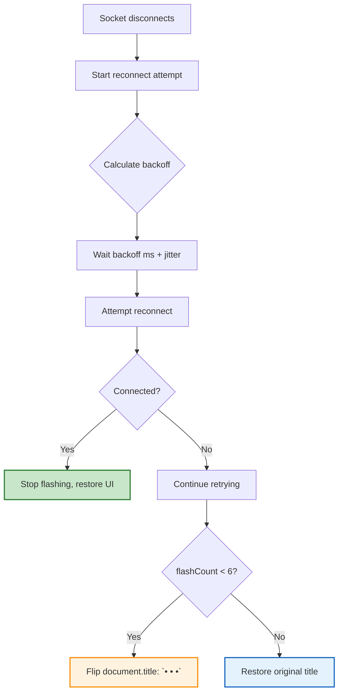

# Frontend Documentation

> The client is a Next.js 16 / React 19 app in a Bun + Turborepo monorepo under `frontend/`.
> Full reference, including the routing model, the data layer, session handling and the chart system.

---

## 1. WebSocket Client

### 🔌 Connection Configuration

```typescript
// One socket per browser tab, market-scoped, anonymous allowed
const ws = new WebSocket(`${WS_BASE_URL}/ws/markets/${marketId}`, {
  credentials: "include",  // sends HttpOnly cookies for session binding
});

// Per-market subscription multiplexing — one tab subscribes to all markets it needs
ws.subscribe = (channel: string) => {
  ws.send(JSON.stringify({ type: "subscribe", channel }));
};

ws.unsubscribe = (channel: string) => {
  ws.send(JSON.stringify({ type: "unsubscribe", channel }));
};
```

### 📡 Event Types Received from Server

| Event Type | Payload | Description |
|------------|---------|-------------|
| `market:price_update` | `{market_id, yes_price, no_price}` | Real-time AMM price changes |
| `market:order_book` | `{market_id, bids, asks}` | Order book depth updates |
| `trade:new` | `{market_id, price, amount, side}` | New trade executed |
| `market:resolved` | `{market_id, winning_outcome}` | Market resolved (winners paid) |
| `comment:vote` | `{comment_id, username, vote_type}` | **NEW**: Upvote/downvote on comments |
| `comment:new` | `{comment_id, content, user_id}` | **NEW**: New comment appears |
| `comment:updated` | `{comment_id, content, edited_at}` | **NEW**: Comment edited |
| `comment:deleted` | `{comment_id}` | **NEW**: Comment removed |

### 🖼️ Image: WebSocket Event Flow


*Figure 1: WebSocket events received by frontend client*

---

## 2. Faster WebSocket Reconnection

### 🔄 Backoff Sequence (NEW vs OLD)

| Attempt | New Backoff | Old Backoff | Improvement |
|---------|-------------|-------------|-------------|
| 0 | **200ms** | 500ms | 2.5× faster |
| 1 | **350ms** | 1s | 2.8× faster |
| 2 | **600ms** | 2s | 3.3× faster |
| 3 | **1s** | 4s | 4× faster |
| 4 | **2s** | 8s | 4× faster |
| 5 | **4s** | 16s | 4× faster |
| 6+ | **8s** (capped) | 32s | 4× faster |

### ⚡ Jitter (±50%)

```typescript
// backoff.ts — Prevents thundering herd across all tabs
function calculateBackoff(attempt: number): number {
  const baseBackoffs = [200, 350, 600, 1000, 2000, 4000, 8000]; // ms
  const base = baseBackoffs[attempt] ?? 8000;
  
  // ±50% jitter to distribute reconnection attempts
  const jitter = Math.random() * 0.5 + 0.75; // 0.75 to 1.25
  return Math.round(base * jitter);
}
```

### 📷 Tab Flashing Effect

```typescript
// use-market-socket.tsx — Alert user on reconnect
useEffect(() => {
  let flashing = true;
  let flashCount = 0;
  const originalTitle = document.title;
  
  const flash = setInterval(() => {
    if (!flashing) return;
    
    if (flashCount < 6) {
      document.title = `• ${originalTitle}`;
      flashCount++;
    } else {
      document.title = originalTitle;
      clearInterval(flash);
      flashing = false;
    }
  }, 200);
  
  return () => {
    flashing = false;
    clearInterval(flash);
    document.title = originalTitle;
  };
}, []);
```



### 🖼️ Image: Reconnection Backoff Sequence


*Figure 2: Faster reconnection backoff with jitter*

### 🖼️ Image: Tab Flashing Effect


*Figure 3: Tab flashing (`• • •`) alerts user on reconnection*

---

## 3. Grid Price Updates (Faster Flush)

### 🔄 Flush Configuration

| Configuration | Value | Description |
|-------------|-------|-------------|
| **Flush Interval** | **150ms** (was 250ms) | Faster price updates |
| **Min Interval** | 20ms | Prevents spin loops |
| **Max Interval** | 500ms | Idle state |
| **Saturation Ratio** | 60% | If flush consumes >60% of interval, shorten next interval by 50ms |
| **Step Size** | 50ms | Incremental adjustment |

```typescript
// market-socket.ts — Grid flush with adaptive interval
class PriceFlusher {
  private buffer: PricePoint[] = [];
  private timeoutId: NodeJS.Timeout | null = null;
  private interval = 150; // ms
  private minInterval = 20;
  private maxInterval = 500;
  private saturationRatio = 0.6;
  private stepSize = 50;
  
  addPrice(price: PricePoint) {
    this.buffer.push(price);
    
    if (this.timeoutId) return; // already scheduled
    
    this.timeoutId = setTimeout(() => this.flush(), this.interval);
  }
  
  flush() {
    this.timeoutId = null;
    
    // Send buffered prices to UI
    if (this.buffer.length > 0) {
      this.onPriceUpdate(this.buffer.splice(0));
    }
    
    // Adaptive interval adjustment
    const utilization = /* calculate % of interval spent */;
    if (utilization > this.saturationRatio) {
      this = Math.max(this.minInterval, this.interval - this.stepSize);
    } else if (utilization < this.saturationRatio * 0.5) {
      this = Math.min(this.maxInterval, this.interval + this.stepSize);
    }
  }
}
```

### 🖼️ Image: Grid Flush Configuration


*Figure 4: Grid flush configuration parameters*

### 🖼️ Image: Adaptive Flush Interval


*Figure 5: Adaptive flush interval based on saturation ratio*

---

## 4. Comment Voting Frontend

### 🎯 useVote Hook

```typescript
// hooks/use-vote.ts — Comment voting with idempotency + instant cache update
function useVote(commentId: string) {
  const { data: user } = useUser()
  const queryClient = useQueryClient()
  
  const handleVote = async (voteType: 1 | -1) => {
    // 1. API call (rate-limited, returns 429 if exceeded)
    const response = await api.post(`/markets/${marketSlug}/comments/${commentId}/vote`, {
      vote_type: voteType,
    })
    
    // 2. Instant cache update (Frontend setQueryData pattern)
    queryClient.setQueryData(
      ['market', marketSlug, 'comments'],
      (old: Comment[]) => old.map(c =>
        c.id === commentId ? { ...c, vote_type: response.vote_type, ...response } : c
      )
    )
    
    // 3. WebSocket event received automatically
    // (comment:vote → UI updates via useSocketFrame)
    
    return response
  }
  
  return { handleVote, isRateLimited, retryAfter }
}
```

### 🖼️ Image: Vote Flow with Instant Cache Update


*Figure 6: Vote flow with Frontend setQueryData for instantaneous UI update*

### 🖼️ Image: Vote Types UI


*Figure 7: Upvote (↑) and Downvote (↓) button states*

---

## 5. Referrals Page with URL Parameters

### 📍 Page Component

```tsx
// frontend/apps/web/app/(app)/settings/referrals/page.tsx
export default function ReferralsPage() {
  const { data: codeData, isLoading: codeLoading } = useReferralCode()
  const { data: statsData } = useReferralStats()
  const searchParams = useSearchParams()
  
  // Read URL parameters
  const refParam = searchParams.get("ref") ?? undefined
  const utmParam = searchParams.get("utm_source") ?? undefined
  const redirectParam = searchParams.get("redirect") ?? undefined
  
  // Build referral link with UTM parameters
  const referralCode = codeData?.referral_code ?? null
  const origin = typeof window !== "undefined" ? window.location.origin : ""
  
  const referralLink = referralCode
    ? `${origin}/register?ref=${referralCode}&utm_source=website&utm_medium=referral&utm_campaign=referral_program`
    : ""
  
  // Extract referral code from URL
  const urlReferralCode = refParam || undefined
  
  // Apply redirect after signup
  const redirectTo = redirectParam || "/markets"
  
  // Display traffic source
  {utmParam && (
    <div className="mt-4 p-3 bg-muted rounded-lg text-sm text-muted-foreground">
      <p className="font-medium">Traffic source detected:</p>
      <p className="mt-1">{utmParam}</p>
    </div>
  )}
  
  // Show redirect notice
  {redirectParam && (
    <div className="mt-4 p-3 bg-muted rounded-lg text-sm text-muted-foreground">
      <p className="font-medium">Redirect after signup:</p>
      <p className="mt-1">{redirectParam}</p>
    </div>
  )}
  
  // Visitor came via referral code
  {refParam && (
    <p className="text-xs text-muted-foreground mb-2">
      Visitor came via referral code: {refParam}
    </p>
  )}
```

### 🖼️ Image: Referrals Page URL Parameters


*Figure 8: URL parameters (ref, utm_source, redirect) on referrals page*

### 🖼️ Image: Referral Code Copy


*Figure 9: Referral code copy button and link sharing*

---

## 6. Authentication (Frontend)

### 🍪 Cookie Handling

```typescript
// lib/api/client.ts — All requests include credentials: "include"
const api = createApiClient({
  baseURL: import.meta.env.VITE_API_BASE_URL,
  credentials: "include",  // sends HttpOnly cookies automatically
  headers: {
    "Content-Type": "application/json",
  },
})
```

### 🔐 Session Validation

```typescript
// deps.py (backend) — get_current_user() dependency
# Checks:
# 1. access_token cookie present
# 2. JWT decoded with jwt_secret
# 3. jti matches active session row
# 4. Session.revoked == False
# 5. Token not expired (exp > now)
```

### 🖼️ Image: Authentication Flow


*Figure 10: Frontend authentication with HttpOnly cookies*

---