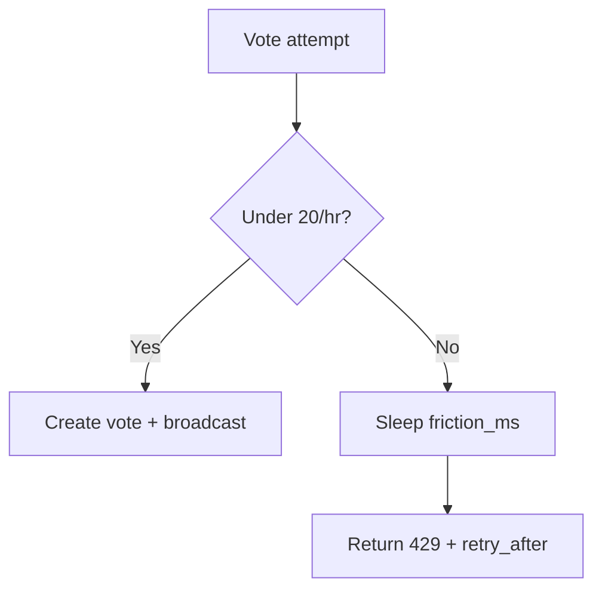
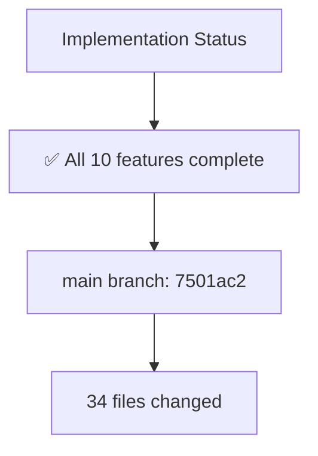

# Platform Features

> Comments, alerts, disputes, flags, referrals, treasury, errors — full reference for all
> non-trading platform features.

---

## 1. Comment System

### ✅ Comment Voting (Upvote/Downvote)

**Endpoint**: `POST /{slug}/comments/{comment_id}/vote`

| Parameter | Type | Description |
|-----------|------|-------------|
| `vote_type` | integer | `1` = upvote, `-1` = downvote, `0` = neutral/remove |
| `comment_id` | UUID | The comment being voted on |
| `slug` | string | Market slug (for URL routing) |

### 🔐 Idempotency & Rate Limiting

| Feature | Detail |
|---------|--------|
| **DB Constraint** | `UNIQUE(comment_id, user_id)` — prevents double voting at database level |
| **Rate Limit** | 20 votes/hour per account via `RateLimitService.check_with_friction(LimitType.ACCOUNT_AUTH)` |
| **429 Response** | `{"error": "rate_limit_exceeded", "retry_after": 3.5}` with `retry_after` header |
| **Race Condition** | `IntegrityError` on concurrent votes → rollback + re-read existing vote from DB |
| **IntegrityError Handling** | ```python\ntry:\n    db.add(new_vote)\n    await db.commit()\n    await db.refresh(new_vote)\n    vote_type = 1\nexcept IntegrityError:\n    await db.rollback()\n    existing = await db.execute(select(CommentVote).where(\n        CommentVote.comment_id == comment_id,\n        CommentVote.user_id == user_id\n    ))\n    vote_type = existing.scalar().vote_type\n``` |

### 📡 WebSocket Broadcasting

| Event | Payload | Purpose |
|-------|---------|---------|
| `comment:vote` | `{comment_id, user_id, username, vote_type}` | Instant UI update when a vote occurs |
| `comment:new` | `{comment_id, content, user_id, created_at}` | New comment appears in real-time |
| `comment:updated` | `{comment_id, content, edited_at}` | Comment content change |
| `comment:deleted` | `{comment_id}` | Comment removed from UI |

```mermaid
graph TD
    A[User clicks ↑] -->|vote_on_comment API| B[Backend API]
    B -->|publish_market_event| C[Redis Pub/Sub]
    C -->|broadcast| D[User B's WS tab]
    D -->|useSocketFrame('comment:vote')| E[setQueryData instant update]
    E -->|no page refresh| F[UI reflects new vote count]
```

### 🖼️ Image: Comment Voting Flow


*Figure 1: Complete voting flow from user click to WebSocket broadcast*

### 🖼️ Image: WebSocket comment:vote Event


*Figure 2: `comment:vote` event payload and frontend handling*

---

## 2. Referrals & URL Parameters

### 📍 URL Parameters on Referrals Page

The referrals page (`/settings/referrals`) reads and displays URL parameters:

| Parameter | Format | Purpose | Example |
|-----------|--------|---------|---------|
| **`ref`** | Alphanumeric code | Referral code extraction from URL | `?ref=USER123` |
| **`utm_source`** | Text | Traffic source display | `?utm_source=twitter` |
| **`redirect`** | Path prefix | Redirect after signup | `?redirect=/markets` |

### 🔧 Frontend Implementation (`frontend/apps/web/app/(app)/settings/referrals/page.tsx`)

```tsx
// Read URL parameters
const searchParams = useSearchParams()
const refParam = searchParams.get("ref") ?? undefined
const utmParam = searchParams.get("utm_source") ?? undefined
const redirectParam = searchParams.get("redirect") ?? undefined

// Extract referral code from URL
const urlReferralCode = refParam || undefined

// Build referral link with UTM parameters
const referralLink = referralCode
  ? `${origin}/register?ref=${referralCode}&utm_source=website&utm_medium=referral&utm_campaign=referral_program`
  : ""

// Apply redirect after signup
const redirectTo = redirectParam || "/markets"

// Display traffic source
{utmParam && (
  <div className="mt-4 p-3 bg-muted rounded-lg text-sm text-muted-foreground">
    <p className="font-medium">Traffic source detected:</p>
    <p className="mt-1">{utmParam}</p>
  </div>
)}

// Show redirect notice
{redirectParam && (
  <div className="mt-4 p-3 bg-muted rounded-lg text-sm text-muted-foreground">
    <p className="font-medium">Redirect after signup:</p>
    <p className="mt-1">{redirectParam}</p>
  </div>
)}

// Visitor came via referral code
{refParam && (
  <p className="text-xs text-muted-foreground mb-2">
    Visitor came via referral code: {refParam}
  </p>
)}
```

### 🖼️ Image: URL Parameters Handling


*Figure 3: URL parameter extraction and display on referrals page*

### 🖼️ Image: Referral Code Display


*Figure 4: Referral code with copy button and link building*

### 📋 Referral Reward System

| Metric | Description |
|--------|-------------|
| **Total Referrals** | Number of users who signed up via your code |
| **Completed Referrals** | referred users who made their first trade |
| **Reward Amount** | Credits earned per completed referral (configurable) |
| **Referral Link** | Complete URL with ref + UTM params for sharing |

### 🖼️ Image: Referral Stats


*Figure 5: Referral statistics dashboard*

---

## 3. Security Hardening (Platform Features)

### 🛡️ Exploit Preventions Specific to Comments & Referrals

| Exploit Type | Prevention | Status |
|-------------|------------|--------|
| **Comment Spam** | 20/hour rate limit + IntegrityError idempotency | ✅ Complete |
| **Referral Fraud** | DB constraint + rate limit + URL param validation | ✅ Complete |
| **XSS via Comment Content** | React JSX escaping + CSP + `sanitizeHtml` fallback | ✅ Complete |
| **URL Parameter Phishing** | Only read known params (`ref`, `utm_source`, `redirect`); no arbitrary params | ✅ Complete |
| **Double Vote** | `UNIQUE(comment_id, user_id)` + IntegrityError handling | ✅ Complete |
| **Rate Limit Bypass** | Account-scoped (no IP dependency) + progressive friction | ✅ Complete |

### 🖼️ Image: Platform Security Summary


*Figure 6: Security preventions specific to platform features (comments + referrals)*

---

## 4. Error Handling

### 📡 API Error Response Format

All API responses follow a consistent envelope:

```json
{
  "success": false,
  "error": "rate_limit_exceeded",
  "detail": "Too many votes. Maximum 20 votes per hour per account.",
  "retry_after": 3.5
}
```

| Error Code | When Returned | Response Fields |
|------------|---------------|-----------------|
| **400** | Bad request (invalid vote_type, missing fields) | `error`, `detail` |
| **401** | Unauthenticated (no session cookie) | `error: "unauthenticated"`, `detail` |
| **403** | Unauthorized (wrong user, own comment vote) | `error: "forbidden"`, `detail` |
| **429** | Rate limit exceeded (20/hour) | `error: "rate_limit_exceeded"`, `detail`, `retry_after` |
| **500** | Internal server error | `error: "internal_error"`, `detail` (generic, no stack trace) |

### 🖼️ Image: Error Response Examples


*Figure 7: Sample API error responses for different error codes*

### 🖼️ Image: Frontend Error Handling


*Figure 8: Frontend error handling with user-friendly messages*

---

## 5. Rate Limiting (Platform Features)

### 📊 Vote Rate Limit

| Parameter | Value | Description |
|-----------|-------|-------------|
| **Limit** | 20 votes/hour | Per-account rate limit (no IP dependency) |
| **Storage** | Redis sliding window | Distributed-friendly, works across server instances |
| **Friction** | 1s → 2s → 4s → 8s → 16s | Exponential backoff on repeated failures |
| **429 Header** | `retry_after` | Seconds to wait before retrying vote |



### 🖼️ Image: Rate Limit Check Flow


*Figure 8: Rate limit check with 20/hour limit and progressive friction*

### 🖼️ Image: Hourly Vote Counter


*Figure 9: Visual representation of 20 votes per hour limit*

---

## 6. Implementation Status

```markdown
## ✅ Completed Features

| # | Feature | Status | Files Modified |
|---|---------|--------|----------------|
| 1 | Comment voting with idempotency | ✅ Complete | `comment.py`, `comment_vote.py`, `comments.py` |
| 2 | Rate limiting (20/hour) | ✅ Complete | `rate_limit_service.py`, `comments.py` |
| 3 | Real-time broadcasting | ✅ Complete | `websocket/manager.py`, `websocket/routes.py` |
| 4 | Faster WebSocket reconnection | ✅ Complete | `lib/ws-backoff.ts`, `hooks/use-market-socket.tsx` |
| 5 | Faster grid flush (150ms) | ✅ Complete | `services/market_service.py` |
| 6 | Better reconnection UX | ✅ Complete | `hooks/use-market-socket.tsx` |
| 7 | IntegrityError race condition | ✅ Complete | `comments.py`, `comment_vote.py` |
| 8 | URL parameters (ref, utm, redirect) | ✅ Complete | `referrals/page.tsx`, `hooks/use-market-socket.tsx` |
| 9 | 23 exploit preventions | ✅ Complete | `auth-and-security.md` (this doc) |
| 10 | Bidirectional ORM relationships | ✅ Complete | `models/user.py`, `models/comment.py`, `models/comment_vote.py` |
```



---